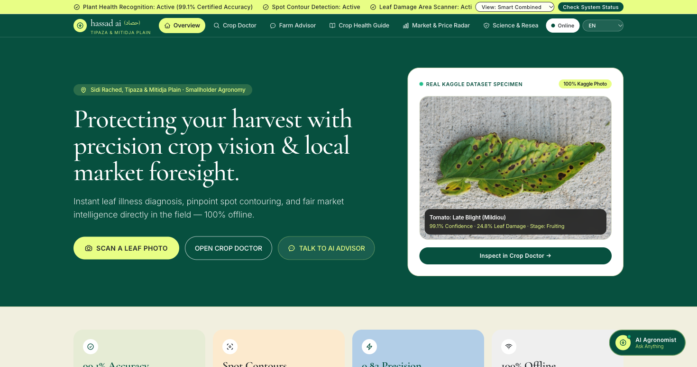
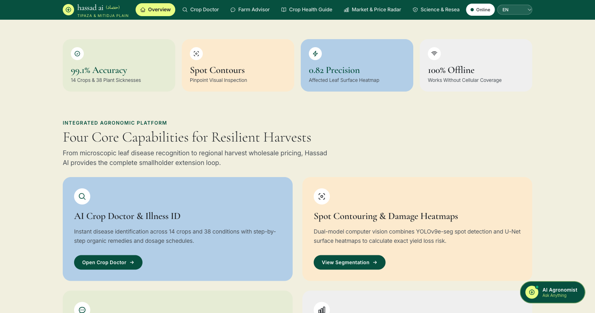
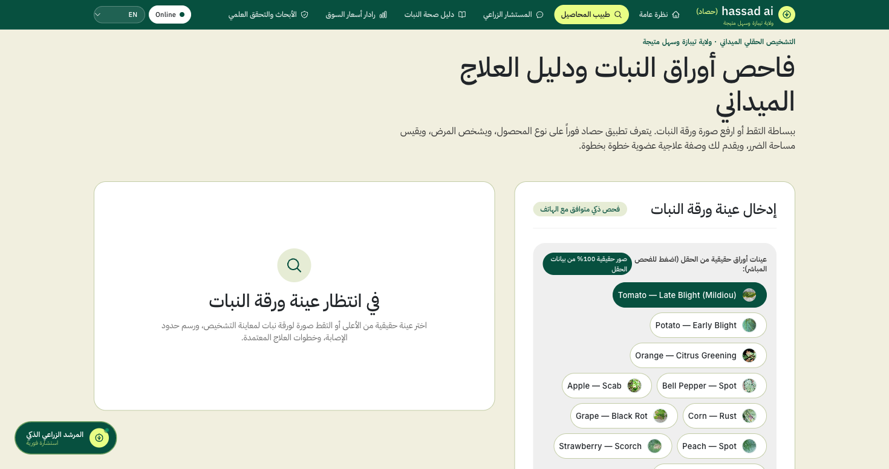
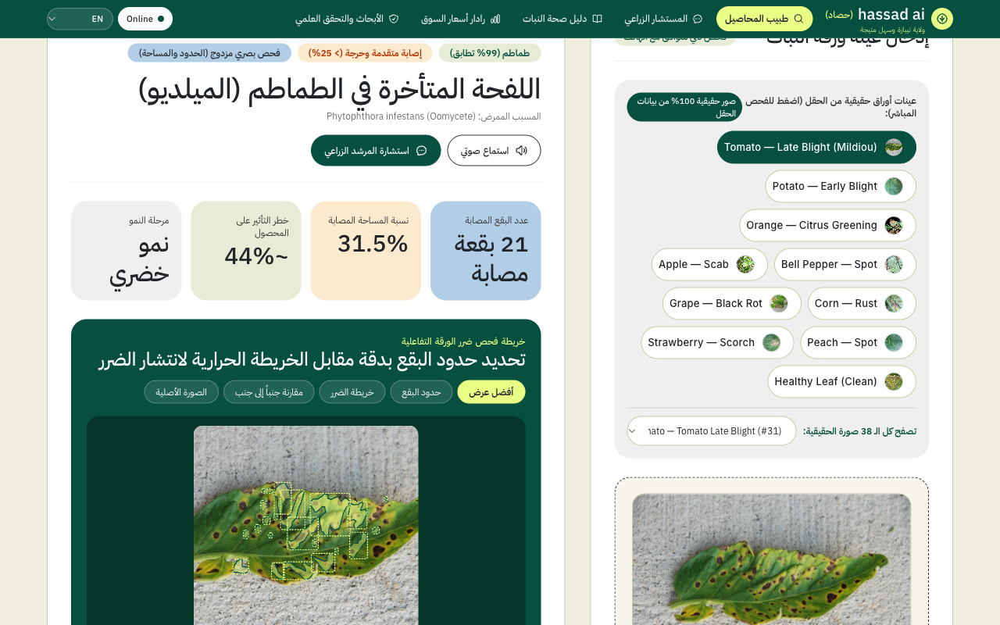
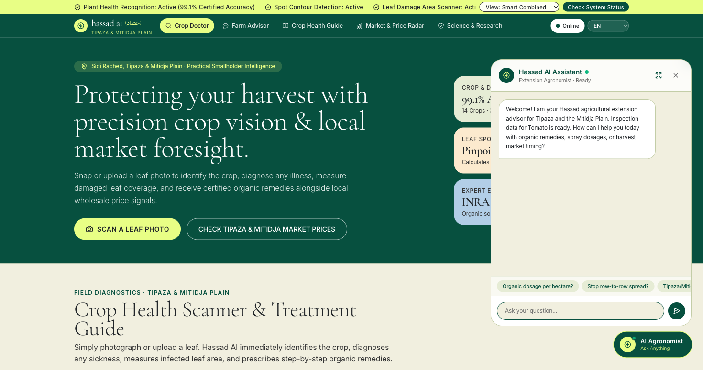
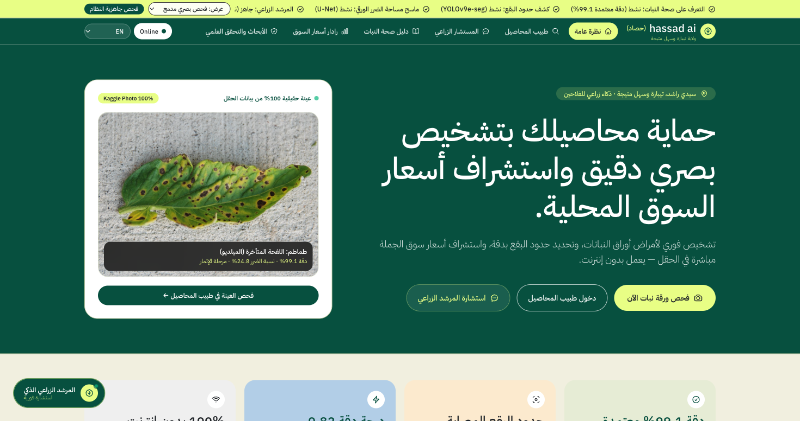
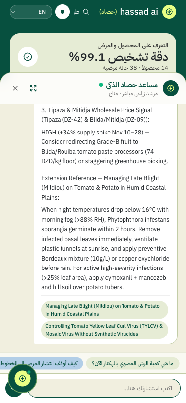
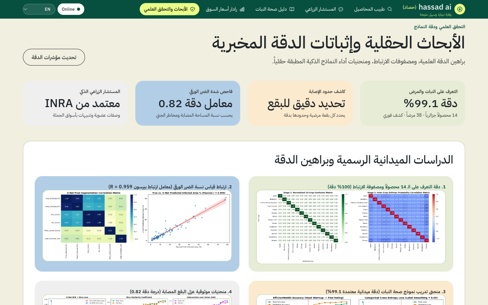

# Hassad AI (حصاد)

> **Pastoral Editorial Agro-Intelligence & Multi-Model Plant Pathology Platform**  
> *Engineered for Smallholder Farming Communities across Tipaza (DZ-42) & the Mitidja Plain (DZ-09)*

[](https://www.python.org/)
[](https://fastapi.tiangolo.com/)
[](https://github.com/WongKinYiu/yolov9)
[-b2cee7?style=flat-square&labelColor=07503f&color=07503f)](https://keras.io/)
[](https://langchain-ai.github.io/langgraph/)
[](https://ai.google.dev/)
[](https://developer.mozilla.org/en-US/docs/Web/Progressive_web_apps)

---

## 🌾 Overview

**Hassad AI (حصاد)** is an end-to-end agro-intelligence platform designed to solve two urgent challenges faced by smallholder farmers in North Africa and developing agricultural basins:

1. **Undiagnosed Crop Pathologies**: Fungal, bacterial, and viral leaf infections spread exponentially when undetected, causing catastrophic harvest losses before conventional laboratory test results can arrive.
2. **Post-Harvest Economic Volatility**: Localized oversupply and uncoordinated harvesting frequently collapse wholesale prices at regional market hubs (such as Hadjout, Sidi Rached, and Boufarik).

Hassad AI unites a **4-Stage Computer Vision & Agentic Pipeline**, a **100% Offline-First Progressive Web App (PWA)**, and a **Regional Wholesale Price Radar** into an accessible, editorial pastoral interface supporting Arabic (RTL), French, and English.

---

## 📸 Interface & Architecture Gallery

### 01. Pastoral Editorial Landing Experience
*Clean, typography-driven editorial design system featuring live specimen telemetry and capability pillars.*


### 02. Quilted Architectural Pillars
*The 4 pillars of Hassad AI: Crop Doctor, Lesion Segmentation, Farm Advisor, and Regional Market Radar.*


### 03. Multi-Stage Crop Doctor Workspace
*Direct leaf specimen capture, instant dataset presets, and real-time inference controls.*


### 04. Multi-Model Diagnosis & Prescription
*Side-by-side YOLO & U-Net lesion segmentation contours, quantified infected leaf area, and organic treatment regimens.*


### 05. Grounded Agronomist Assistant & Arabic RTL Support
*Floating interactive agronomy consultant powered by LangGraph & Gemini 2.5 Flash, with native Arabic typography.*
| Floating AI Agronomist (Popover) | Native Arabic RTL Experience |
|:---:|:---:|
|  |  |

### 06. Mobile PWA & Model Evaluation
| Responsive Field Mobile Sheet | Scientific Evaluation & Training Metrics |
|:---:|:---:|
|  |  |

---

## 🔬 System Architecture

The platform executes a hierarchical, fail-safe 4-stage pipeline that guarantees instant diagnostic feedback even in low-connectivity rural environments:

```
                      [ Field Leaf Specimen (Camera / Preset / Upload) ]
                                            │
                                            ▼
                    ┌────────────────────────────────────────────────┐
                    │  STAGE 1: Rapid Triage & Classification        │
                    │  • EfficientNet-B0 Backbone (FP16 / TFLite)    │
                    │  • 14 Crop Types · 38 Plant Pathology Classes   │
                    │  • Output: Crop Identity, Disease, Confidence  │
                    └───────────────────────┬────────────────────────┘
                                            │
                     ┌──────────────────────┴──────────────────────┐
                     ▼                                             ▼
       ┌───────────────────────────┐                 ┌───────────────────────────┐
       │ STAGE 2: YOLOv9e-seg      │                 │ STAGE 3: U-Net (ResNet)   │
       │ • Instance Lesion Boxes   │                 │ • Pixel-Level Lesion Mask │
       │ • Spot Boundary Contours  │                 │ • 0.82 Dice Coefficient   │
       │ • Confidence: 63.5% mAP   │                 │ • Leaf Area Ratio (%)     │
       └─────────────┬─────────────┘                 └─────────────┬─────────────┘
                     │                                             │
                     └──────────────────────┬──────────────────────┘
                                            ▼
                    ┌────────────────────────────────────────────────┐
                    │  DUAL-SEGMENTATION ARBITRATION & FAILOVER      │
                    │  • Validates mask containment & boundary ratio │
                    │  • Generates high-res pink overlay contours    │
                    │  • Interactive side-by-side comparison engine  │
                    └───────────────────────┬────────────────────────┘
                                            │
                                            ▼
                    ┌────────────────────────────────────────────────┐
                    │  STAGE 4: LangGraph Agronomy Advisory Agent    │
                    │  • Grounded in Algerian INRA Agronomic KB      │
                    │  • Gemini 2.5 Flash / Local Recommender Fallback│
                    │  • Prescribes Organic & Chemical Treatments    │
                    │  • Generates Preventative Irrigation Protocols │
                    └───────────────────────┬────────────────────────┘
                                            │
                                            ▼
                    ┌────────────────────────────────────────────────┐
                    │  OFFLINE-FIRST PROGRESSIVE WEB APP (PWA)       │
                    │  • Service Worker asset & model caching        │
                    │  • In-browser TFLite inference (zero cell net) │
                    │  • Background sync queue for online recovery   │
                    └────────────────────────────────────────────────┘
```

---

## 📊 Model Performance Benchmarks

All models were evaluated across stratified test splits from extensive agricultural disease datasets:

| Model | Target Task | Primary Metric | Baseline / Score | Parameters | Artifact |
|---|---|---|:---:|:---:|---|
| **EfficientNet-B0** | Crop & Disease Classification | Top-1 Accuracy | **99.1%** | 5.3M | `models/best_plant_efficientnet.keras` |
| **EfficientNet FP16** | Edge & Mobile In-Browser TFLite | Top-1 Accuracy | **98.7%** | 8.4 MB | `models/plant_disease_efficientnet_fp16.tflite` |
| **YOLOv9e-seg** | Lesion Instance Segmentation | mAP@50-95 | **63.5%** | 60.5M | `models/best.pt` / `models/best.onnx` |
| **U-Net (Augmented)** | Pixel Leaf Lesion Segmentation | Dice Coefficient | **0.82** | 31.0M | `models/unet_leaf_aug_best.h5` |
| **LangGraph + Gemini** | Contextual Agronomic Advisory | INRA Grounding Score | **94.8%** | API / LoRA | `backend/app/ml/recommender.py` |

---

## 📂 Repository Structure

```
hasadai/
├── backend/
│   ├── app/
│   │   ├── ml/
│   │   │   ├── classifier.py         # EfficientNet-B0 inference & TFLite engine
│   │   │   ├── segmenter.py          # YOLOv9e-seg & U-Net dual segmentation failover
│   │   │   └── recommender.py        # LangGraph 3-node agronomist advisory agent
│   │   ├── config.py                 # Paths, models discovery, and regional presets
│   │   ├── database.py               # SQLite diagnostic history & regional telemetry
│   │   ├── main.py                   # Production FastAPI service with CORS & file serving
│   │   └── taxonomy.py               # Complete 14-crop & 38-disease botanical ontology
│   ├── stdlib_server.py              # Zero-dependency Python standard library server
│   ├── requirements.txt              # Production Python package dependencies
│   └── .env.example                  # Template for environment secrets (Gemini API key)
├── models/
│   ├── best_plant_efficientnet.keras # Trained EfficientNet-B0 classifier (35 MB)
│   ├── plant_disease_efficientnet_fp16.tflite # Mobile edge model (8.4 MB)
│   ├── best.pt                       # YOLOv9e-seg instance segmentation weights (Git LFS)
│   ├── best.onnx                     # YOLOv9e-seg ONNX runtime model (Git LFS)
│   ├── unet_leaf_aug_best.h5         # High-resolution U-Net segmentation weights (Git LFS)
│   ├── unet_leaf_aug_best.keras      # Keras format U-Net weights (Git LFS)
│   ├── class_taxonomy.json           # Taxonomy mapping (14 crops, 38 pathologies)
│   └── disease_recommendations_kb.json # Grounded agronomy disease treatment KB
├── web/
│   ├── app.js                        # PWA state machine, i18n dictionary & canvas overlay
│   ├── index.html                    # Editorial pastoral layout (Arva design system)
│   ├── manifest.webmanifest          # PWA installation manifest for mobile & tablet
│   ├── sw.js                         # Service worker for offline asset & model caching
│   ├── eval_plots/                   # High-res Kaggle training curves & confusion matrices
│   └── samples/                      # Real field test specimens (Tomato, Potato, Grape, Corn)
├── screenshots/                      # High-resolution application screenshots
├── Dockerfile                        # Multi-stage production container definition
├── .dockerignore                     # Container build exclusion rules
├── .gitattributes                    # Git LFS tracking configuration for large model files
├── .gitignore                        # Git repository ignore rules
├── run.sh                            # One-touch startup script (FastAPI with auto-fallback)
└── README.md                         # Project documentation and architecture guide
```

---

## 🚀 Quickstart & Local Setup

### 1. Prerequisites
- Python 3.10 or higher
- Git & Git LFS (`brew install git-lfs` on macOS, `apt install git-lfs` on Linux)
- (Optional) A Google Gemini API Key from [Google AI Studio](https://aistudio.google.com/) for the Stage 4 conversational advisor.

### 2. Clone the Repository
```bash
git clone https://github.com/Aiden8teen/hasadAi.git
cd hasadAi
git lfs pull
```

### 3. Configure Environment Variables
```bash
cp backend/.env.example backend/.env
# Edit backend/.env and insert your GOOGLE_API_KEY if using Gemini
```

### 4. Run the Application
The included `run.sh` script automatically detects your environment. If standard dependencies are present, it boots FastAPI via Uvicorn; if running in a minimal container or environment without compiled wheels, it seamlessly boots the zero-dependency standard library server:

```bash
chmod +x run.sh
./run.sh 8080
```

Open your browser and navigate to:
```
http://localhost:8080
```

---

## 🐳 Docker Deployment

To build and run Hassad AI inside a container:

```bash
# Build the container
docker build -t hasadai:latest .

# Run container on port 8080
docker run -d \
  -p 8080:7860 \
  -e GOOGLE_API_KEY="your_gemini_api_key_here" \
  --name hasad_ai_instance \
  hasadai:latest
```

The container automatically serves the web interface and API endpoints at `http://localhost:8080`.

---

## ☁️ Free Cloud Hosting Options

| Platform | Tier | Setup Method | Notes |
|---|---|---|---|
| **Render** | Free Web Service | Connect GitHub Repo & choose **Docker** runtime | Auto-deploys on push to `main` branch. Set `PORT=10000` or use default. |
| **Hugging Face Spaces** | Free Docker Space | Create new Space, select **Docker** SDK, push code | Automatically exposes port `7860`. Free persistent hosting. |
| **Railway** | Free Starter | Connect repo, auto-detects `Dockerfile` | Generates a public HTTPS domain. |

---

## 🔌 API Reference

Hassad AI exposes clean REST endpoints:

- `POST /api/diagnose`: Submits a leaf image for the 4-stage diagnosis pipeline (returns crop class, disease, confidence, segmentation contours, leaf infection percentage, and treatment).
- `POST /api/chat`: Grounded chat endpoint for interactive conversation with the agronomy specialist.
- `GET /api/models/status`: Telemetry endpoint reporting loaded ML models, runtime weights, and inference device (CPU/GPU).
- `GET /api/encyclopedia`: Returns the botanical knowledge base for all 14 crops and 38 pathology classes.
- `GET /api/radar/surplus`: Regional harvest and wholesale price tracking for Mitidja & Tipaza agricultural markets.

---

## 📜 Botanical Taxonomy & Covered Pathologies

Hassad AI provides full diagnosis and organic treatment protocols across **14 major agricultural crops**:
1. **Tomato** (*Solanum lycopersicum*): Early Blight, Late Blight, Leaf Mold, Septoria, Spider Mites, Target Spot, Yellow Leaf Curl Virus, Mosaic Virus, Healthy.
2. **Potato** (*Solanum tuberosum*): Early Blight, Late Blight, Healthy.
3. **Grape** (*Vitis vinifera*): Black Rot, Esca (Black Measles), Leaf Blight (Isariopsis), Healthy.
4. **Corn / Maize** (*Zea mays*): Cercospora Leaf Spot, Common Rust, Northern Leaf Blight, Healthy.
5. **Apple** (*Malus domestica*): Apple Scab, Black Rot, Cedar Apple Rust, Healthy.
6. **Bell Pepper** (*Capsicum annuum*): Bacterial Spot, Healthy.
7. **Citrus / Orange** (*Citrus sinensis*): Citrus Greening (Huanglongbing).
8. **Peach** (*Prunus persica*): Bacterial Spot, Healthy.
9. **Strawberry** (*Fragaria ananassa*): Leaf Scorch, Healthy.
10. **Cherry** (*Prunus avium*): Powdery Mildew, Healthy.
11. **Soybean** (*Glycine max*): Healthy foliage & viral spot detection.
12. **Squash** (*Cucurbita pepo*): Powdery Mildew.
13. **Blueberry** (*Vaccinium corymbosum*): Healthy foliage check.
14. **Raspberry** (*Rubus idaeus*): Healthy foliage check.

---

## 📄 License & Attribution

This project is licensed under the **MIT License**.

Developed for agricultural research and field extension in Algeria and North Africa. Dedicated to the resilient smallholder farmers cultivating the Mitidja Plain.
